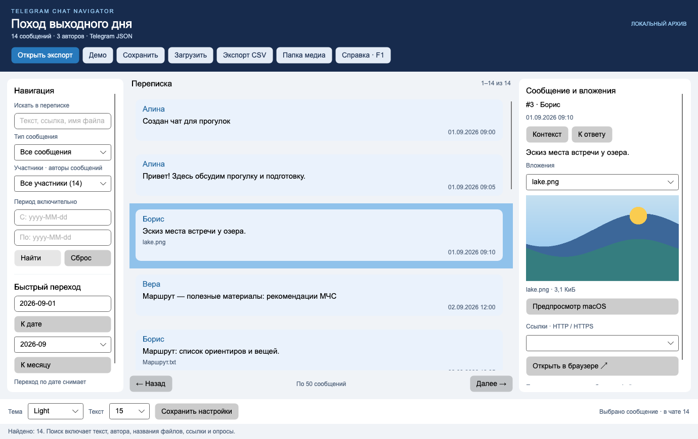

# Telegram Chat Navigator

Учебный проект №20 — локальный навигатор по экспортированному чату Telegram Desktop.
C# / .NET 10, оконный интерфейс Avalonia 12.1.5, общая библиотека Core и CLI.
Открывает JSON и многостраничный HTML, ищет сообщения, показывает авторов, медиа и опросы,
переходит по датам, сохраняет и восстанавливает рабочее состояние.

Репозиторий: [Ibragim29052003/telegram-chat-navigator](https://github.com/Ibragim29052003/telegram-chat-navigator).
Это одна учебная работа. По курсу нужны две отдельные работы; тема этой работы требует согласования с преподавателем.



## Быстрый запуск на Mac Apple Silicon

Откройте **эту папку TelegramChatNavigator** в Visual Studio Code: File → Open Folder.
Команды выполняются в терминале из корня проекта, где находится `TelegramChatNavigator.sln`:

```sh
dotnet --info
dotnet restore --locked-mode
dotnet run --project src/TelegramChatNavigator.Desktop
```

Сразу откроется вымышленный чат: **14 сообщений, три автора**. Никаких аккаунтов или серверов не нужно.
Также можно дважды нажать `scripts/run-mac.command` в Finder.
Остановить окно: закрыть его или Cmd+Q. При запуске через терминал доступен Ctrl+C.
Сохраните состояние кнопкой «Сохранить» перед выходом — чат автоматически не сохраняется.

Для сборки из исходников обязателен .NET SDK 10 arm64; `global.json` разрешает актуальные feature bands .NET 10.
Локально использован SDK **10.0.400**, runtime **10.0.11**, macOS **27.0**, `osx-arm64`.
C# и C# Dev Kit помогают редактировать, отлаживать и просматривать решение в VS Code; для `dotnet run` они не обязательны.
Avalonia не требует MAUI workload, Windows или виртуальной машины. Интернет нужен для первого восстановления NuGet.

## Автономный Mac-релиз

Собрать на Mac:

```sh
./scripts/package-mac.sh
```

Версия Mac-сборки: **1.0.1**. Результат: `artifacts/TelegramChatNavigator.app` и `artifacts/TelegramChatNavigator-osx-arm64.zip`.
В ZIP есть .NET runtime: отдельно устанавливать .NET для этой сборки не требуется.
Архитектура — Apple Silicon, целевая macOS 14 и новее; фактически проверена macOS 27.0.
Используется локальная ad-hoc подпись; notarization Apple не выполнялась.
ZIP проверяется повторной распаковкой и проверкой подписи. Для хранения распакованного `.app`
лучше выбрать локальную папку вне синхронизации iCloud, например `~/Applications`.
Если macOS ограничивает запуск загруженного ZIP, используйте сборку из исходников или штатное разрешение запуска
в Privacy & Security для доверенной собственной сборки; глобально отключать Gatekeeper не нужно.

## Открытие собственного экспорта

В **Telegram Desktop** выберите Export chat history для одного чата.
Выберите Machine-readable JSON или HTML, включите нужные фото/видео/аудио и сохраните папку целиком.
В приложении нажмите «Открыть экспорт» и укажите эту папку.
Если в ней есть оба формата, используется `result.json`.

```sh
dotnet run --project src/TelegramChatNavigator.Desktop -- --open examples/demo
dotnet run --project src/TelegramChatNavigator.Desktop -- --state /tmp/chat.tgnav.json
dotnet run --project src/TelegramChatNavigator.Cli -- --help
dotnet run --project src/TelegramChatNavigator.Cli -- inspect examples/demo
dotnet run --project src/TelegramChatNavigator.Cli -- participants examples/demo
dotnet run --project src/TelegramChatNavigator.Cli -- search examples/demo --text маршрут --kind Link
dotnet run --project src/TelegramChatNavigator.Cli -- save-state examples/demo --text маршрут --out /tmp/chat.tgnav.json
dotnet run --project src/TelegramChatNavigator.Cli -- export /tmp/chat.tgnav.json --out /tmp/messages.csv
```

Поиск `маршрут` даёт **4 сообщения: №4, №5, №12, №14**; вместе с категорией Link — **№4 и №12**.
Это поиск подстроки: `маршрут` и `маршрута` — разные строки. CLI заканчивает работу самостоятельно; Ctrl+C прерывает её.
Даты CLI: `--from 2026-09-01 --to 2026-09-30`; категории — в `--help`. Ошибки возвращают код 2.

## Что умеет окно

- Переписка с авторами, датами, полным текстом выбранного сообщения, ответами и результатами опросов.
- Поиск по тексту, автору, имени файла, ссылкам и опросам; фильтры автора, типа и периода.
- Переход по дню/месяцу, страницы по 50 сообщений; «Контекст» снимает фильтры с сохранением выбора.
- Фото PNG/JPEG/WebP внутри окна; видео, аудио и документы открываются системными приложениями macOS, Windows и Linux.
- Сохранение текста чата, фильтров, выбора и путей к медиа в `.tgnav.json`; восстановление без исходного JSON/HTML.
- CSV текущих результатов; тема System/Light/Dark и размер текста с отдельным сохранением настроек.
- F1 и Cmd+? — справка; Cmd+O/S/L/F — открыть экспорт, сохранить, загрузить, поиск.
  На Mac при мультимедийных клавишах используйте Fn+F1 либо кнопку «Справка».

## Документация для защиты

| Документ | Назначение |
|---|---|
| [Руководство](docs/USER_GUIDE.md) | Что нажать, ввести и увидеть; готовый основной сценарий |
| [Самостоятельная проверка](docs/MANUAL_CHECK.md) | Пошаговый сценарий с командами, ожидаемыми ответами и собственным экспортом Telegram |
| [Соответствие требованиям](docs/REQUIREMENTS.md) | Обязательные пункты, рекомендации, файлы и показ |
| [Устройство кода](docs/ARCHITECTURE.md) | C#, интерфейсы, события, наследование, сложность |
| [Форматы и ограничения](docs/FORMATS.md) | JSON/HTML, состояние, CSV, пути, перенос и кодеки |
| [Защита на 7–10 минут](docs/DEFENSE.md) | Вступление от первого лица, показ, вопросы и план освоения |
| [Проверки](docs/VERIFICATION.md) | Фактические результаты и оставшиеся ручные проверки |
| [Происхождение демо](examples/README.md) | Ожидаемые результаты, авторство ассетов |

## Проверка и структура

```sh
dotnet restore --locked-mode
dotnet build -c Release --no-restore
dotnet test -c Release --no-build --no-restore
dotnet list package --vulnerable --include-transitive
```

`src/TelegramChatNavigator.Core` — общие модели, импорт, поиск, состояние.
`src/TelegramChatNavigator.Desktop` — XAML, ViewModel, диалоги и открытие вложений в системных приложениях.
`src/TelegramChatNavigator.Cli` — команды к той же Core.
`tests/TelegramChatNavigator.Tests` — независимые проверки ответов, ошибок и headless GUI.
CI выполняет restore/build/test и NuGet audit на Windows, Linux и macOS; фактическая платформа выводится через `dotnet --info`.

Полный экспорт аккаунта, `.7z`/ZIP без распаковки, произвольный HTML и восстановление чата в Telegram не поддерживаются.
Участники — авторы из сохранённых сообщений; молчащих участников экспорт не позволяет восстановить.
Медиа остаются внешними файлами. Поддержка кодеков зависит от установленного просмотрщика.
Внешний плеер не встроен в Avalonia; фото отображаются внутри окна.

Первичные источники: [Telegram export](https://telegram.org/blog/export-and-more),
[реализация JSON Telegram](https://github.com/telegramdesktop/tdesktop/blob/dev/Telegram/SourceFiles/export/output/export_output_json.cpp),
[реализация HTML Telegram](https://github.com/telegramdesktop/tdesktop/blob/dev/Telegram/SourceFiles/export/output/export_output_html.cpp),
[.NET на macOS](https://learn.microsoft.com/en-us/dotnet/core/install/macos),
[Avalonia IDE](https://docs.avaloniaui.net/docs/get-started/set-up-your-ide),
[упаковка macOS](https://docs.avaloniaui.net/docs/deployment/macos).
