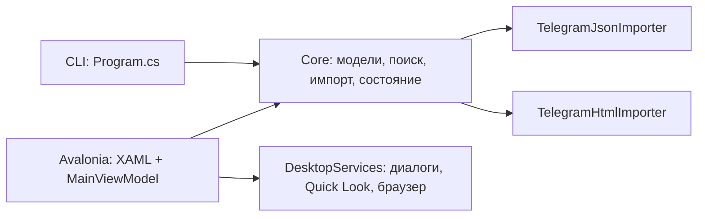

# Как устроен проект

## Граница между логикой и окном

Вся обработка экспорта выполняется на C#. XAML задаёт расположение элементов и привязки.
JavaScript, браузер или сервер для работы не используются. Python/FFmpeg применялись только при подготовке
оригинальных тестовых ассетов; в работающем приложении их нет.

`Core` ссылается только на AngleSharp для разбора HTML и стандартные библиотеки .NET.
Она не знает об Avalonia, Window, Finder или Quick Look. Эту же библиотеку можно использовать
в Console, Web, WPF и других оболочках при совместимом .NET; вторую оболочку здесь реально представляет CLI.

## Основные файлы

| Файл | Роль |
|---|---|
| `Core/Models.cs` | ChatArchive, ChatMessage, Attachment, ChatPoll, Participant, ChatQuery, ChatSearch |
| `Core/ImportSupport.cs` | Выбор импортера, общие ограничения, извлечение текста и типов медиа |
| `Core/TelegramJsonImporter.cs` | JSON одного чата, составной текст, скрытые адреса ссылок, ответы и опросы |
| `Core/TelegramHtmlImporter.cs` | Страницы messages*.html, автор joined-сообщений, даты GMT/UTC, медиа и опросы |
| `Core/Session.cs` | NavigatorSession и событие об изменении состояния |
| `Core/StateStore.cs` | Версионированное состояние, проверка файла до применения, атомарная запись, CSV, настройки |
| `Core/SafePaths.cs` | Относительные пути медиа, проверка символических ссылок, HTTP/HTTPS |
| `Desktop/ViewModels/MainViewModel.cs` | Состояние интерфейса, команды, страницы, выбранное сообщение, фоновые операции |
| `Desktop/ViewModels/ObservableObject.cs` | Уведомления привязок, ICommand с защитой от повторного запуска |
| `Desktop/MainWindow.axaml` | Разметка окна; `.axaml.cs` — клавиатура, запуск, прокрутка выбора |
| `Desktop/DesktopServices.cs` | Только платформенные действия, не алгоритмы чата |
| `Cli/Program.cs` | Проверка аргументов и вызовы той же Core |

В таблице префиксы Core/Desktop/Cli означают папки `src/TelegramChatNavigator.*`.

## Где применены средства C#

**Классы и свойства.** Запись ChatMessage описывает одно сообщение, ChatQuery — фильтр.
`record` даёт свойства, сравнение по значениям и `with` для копирования с изменением.
Настоящие сообщения не переписываются при поиске: меняется только коллекция результатов.

**Коллекции.** Архив и результат представлены IReadOnlyList. GUI использует ObservableCollection для списка;
при смене страницы Avalonia получает уведомления о добавлении/удалении элементов.
HashSet в загрузке состояния обнаруживает дубли ID за линейное ожидаемое время.
Флаги MessageKind позволяют одному сообщению быть одновременно текстом и ссылкой или фотографией.

**Интерфейсы.** IChatImporter реализуют JSON-импортер, HTML-импортер и фасад ChatImporter.
Клиент просит загрузить архив и не зависит от конкретного формата. IDesktopServices отделяет ViewModel
от системных диалогов и запуска браузера. В тестах FakeServices возвращает выбранный путь или отмену;
поиск и сохранение при этом выполняются настоящей Core.

**Событие и полезная подписка.** NavigatorSession создаёт `Changed` при Replace, SetQuery и Select.
MainViewModel подписывается в конструкторе через OnSessionChanged. Обработчик обновляет Activity,
показываемое в нижней строке окна: например «Выбрано сообщение · в чате 14».
При Dispose подписка снимается. Это предметное событие состояния, а не только Click кнопки.
Его отдельно проверяет SessionPublishesDomainChanges.

**Наследование.** SessionChangedEventArgs расширяет EventArgs и несёт причину и количество сообщений.
ObservableObject задаёт общее поведение уведомлений; MainViewModel наследует его и использует Set/Raise.
ChatFormatException наследует Exception, чтобы отличать ошибку формата от отсутствующего файла.
Пустой иерархии участников или вложений ради демонстрации нет.

## Алгоритмы и трудные места

При импорте сообщения сортируются по дате и ID: O(n log n). Проверка повторных идентификаторов — O(n).
Поиск проверяет каждое сообщение и ищет подстроку в его тексте и связанных данных: примерно O(n × L),
где L — длина просматриваемого содержимого. Он без морфологии и регулярных выражений, поэтому поведение просто объяснить.
После чтения один раз сформированного отсортированного списка переход к дате использует lower bound:
делит область поиска пополам и находит первое сообщение с датой не раньше указанной, O(log n).
Построение списка авторов использует группировку по ID; в HTML — по имени, поскольку ID авторов не экспортируются.

Чтение файлов, поиск, сериализация и декодирование фото вынесены в Task.Run из ViewModel.
Во время изменения архива команды работы с ним блокируются IsBusy. Объекты Avalonia меняются после await в UI-потоке.
В ленте максимум 50 записей страницы, но архив хранится целиком в памяти: это не потоковая база данных.
При быстром переключении вложений номер версии предпросмотра не позволяет старой асинхронной загрузке заменить новую картинку.
Предыдущий Bitmap освобождается через Dispose.

Сложность файлов — разные схемы JSON и HTML, составной текст, linked labels, joined-сообщения,
отсутствующее медиа и перенос папки. При сохранении сначала пишется соседний временный файл, затем выполняется Flush
и переименование. Прежний файл не превращается в частично записанный JSON при отмене записи.
Перед заменой текущей сессии загрузка проверяет структуру, версию, даты, коллекции, ID, фильтр и выбор.

## Как проверить понимание

Поставьте breakpoint в ChatSearch.Find, выполните CLI-поиск и пройдите условия по одному.
Потом поставьте breakpoint в OnSessionChanged и выберите сообщение в окне.
Удалите только копию файла фото из демопапки: обработчик должен сообщить о недоступности медиа.
Поменяйте поисковую строку и объясните, почему JSON исходного экспорта остался прежним.
