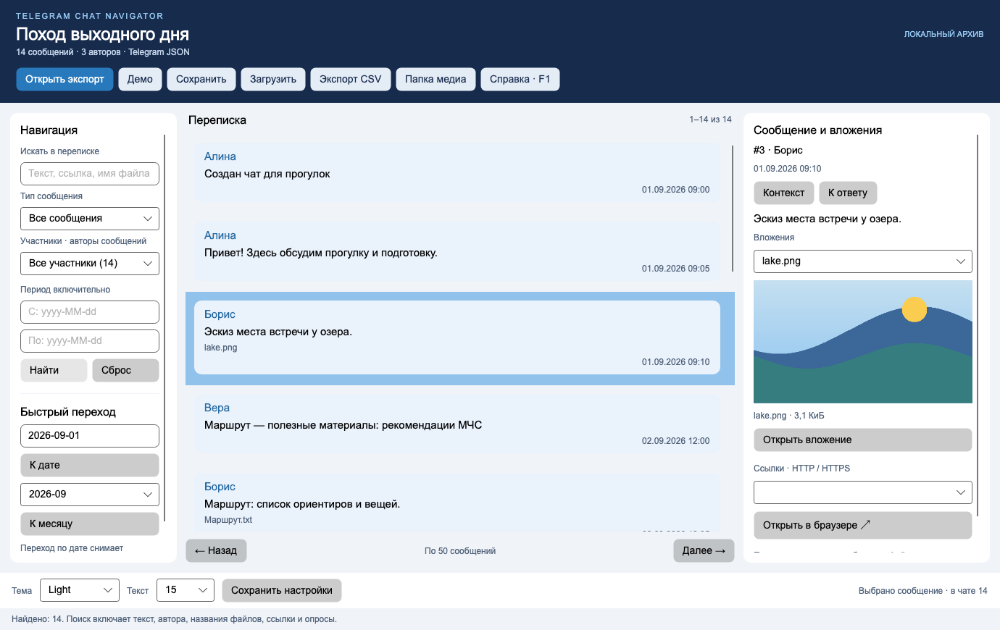

# Проверки и границы результата

Дата отчёта: **5 ноября 2026**. Результаты ниже относятся к подготовленному проекту,
а не к самостоятельной проверке студентом. Перед защитой повторите USER_GUIDE на своём Mac.

## Сборка, зависимости и CI

- Локально: macOS 27.0, Apple Silicon `osx-arm64`, SDK 10.0.400, runtime 10.0.11.
- `dotnet restore --locked-mode` — успешно.
- `dotnet build -c Release --no-restore` — успешно, 0 предупреждений и 0 ошибок.
- `dotnet test -c Release --no-restore` — **49 тестов прошли**, пропусков нет.
- NuGet audit прямых и транзитивных зависимостей — известных уязвимостей в текущем источнике NuGet не найдено.
- [GitHub Actions: успешная проверка](https://github.com/Ibragim29052003/telegram-chat-navigator/actions/runs/41971337835)
  для коммита `f5c934b`: restore/build/test/audit прошли на **Windows x64**, **Ubuntu linux-x64** и **macOS osx-arm64**.
  В каждой задаче прошли 49 тестов. Настоящие окна Windows/Linux и Intel Mac не проверялись.

Версии NuGet закреплены в Directory.Packages.props и packages.lock.json.
«Не найдено известных уязвимостей» означает результат базы NuGet на дату проверки, а не гарантию отсутствия ошибок.

## Библиотека Core

Проверены известные результаты вымышленного экспорта: составной текст и скрытые гиперссылки,
типы вложений, опрос с голосами 2/1 и всего 3, связь ответа №10 → №6, авторы,
поиск без учёта регистра и сочетание автора/типа/дат.
Границы дня включены. Бинарный переход по датам сопоставлен с независимым линейным поиском
для диапазона дней до, внутри и после архива.

Ошибочные случаи: повреждённый JSON, общий экспорт аккаунта, неверный тип сообщения,
неверная дата, дубли ID, пустой архив, отсутствующий источник, неверный HTML, превышение размера,
отмена чтения. Проверено объединение HTML-страниц, наследование автора joined-сообщения,
переносы строк, дата GMT и результаты HTML-опроса.

Для состояния проверены полный цикл сохранения/загрузки, фильтр и выбранный ID, неизвестная версия,
повреждённая структура, отсутствующий выбранный ID, перенос состояния вместе с папкой медиа,
чтение текстов после удаления источника и медиа. Отмена атомарной записи оставляет прежний файл.
Проверены выход пути через `..`, абсолютный путь и символическая ссылка наружу,
запрет `javascript:`/`file:` web-ссылок, CSV с кавычками, переносами и началом строки как формула.
Проверены сохранение/повреждение настроек и предметное событие NavigatorSession.Changed.

Тесты находятся в `tests/TelegramChatNavigator.Tests/CoreTests.cs`.

## CLI: полный пользовательский цикл

Отдельно выполнены настоящие процессы Release CLI:

1. inspect → 14 сообщений; participants → три автора.
2. search `маршрут` + Link → №4 и №12.
3. save-state → повторное открытие состояния → тот же фильтр и два результата.
4. export → CSV независимо прочитан стандартным Python csv.DictReader: две строки, ID и ссылки совпали.
5. Неверная дата, неизвестный ID автора, отсутствующий файл и повреждённое состояние → код завершения 2.
6. HTML-пример из двух страниц → три сообщения.

Маленький реальный пример из материала преподавателя проверен локально в JSON и HTML:
оба формата дали **23 сообщения, одного автора, 7 фотографий, 3 видео, 2 сообщения со ссылками, 3 опроса**.
Некоторые медиа не скачаны самим Telegram Export; приложение сохраняет их категорию и объясняет отсутствие файла.
Чужой чат и его архив не опубликованы.

## Headless GUI и визуальный просмотр

`GuiTests.cs` создаёт настоящее окно Avalonia с разметкой и привязками; системные диалоги подменены FakeServices.
Проверены ввод в TextBox и нажатие мышью «Найти», обновление списка, начальный выбор,
выбор фотографии и декодирование PNG, F1, завершение окна командной клавишей,
сохранение/загрузка/CSV, отмена диалогов, ошибочный файл без потери работы,
дата, ответ, недоступное фото, передача пути предпросмотру и адреса браузеру.

Дополнительный чат из 101 сообщения проверяет границы страниц 1–50, 51–100, 101,
отсутствие выхода за последнюю страницу и восстановление выбранного сообщения №101 на третьей странице.
Найденный дефект сброса выбора при сохранении исправлен и закрыт этой проверкой.

PNG отрисовки просмотрены в светлой и тёмной темах при 1380×870 и 1060×680.
Исправлены контраст верхних кнопок, цвет авторов в тёмной теме и лишние пустые строки карточек.
Проверены места под scrollbar, переносы, отдельная прокрутка панелей и ограничение высоты длинного текста в ленте.
Это отрисовка интерфейса, а не тест системного диалога или медиаплеера.

## Настоящее окно macOS и системные диалоги

Автономный `.app` действительно запускался на Apple Silicon. В финальной версии проверено окно
с заголовком «Поход выходного дня», правильными количеством сообщений и авторами,
фото №3 внутри окна и поиск видеосообщения №8. Внешний вид настоящего окна просмотрен.

До смены текста демочата в настоящем окне дополнительно проверены поиск с четырьмя ожидаемыми результатами,
отмена стандартного Save-диалога без потери результатов, сохранение `.tgnav.json` в выбранный каталог,
сброс фильтра и открытие этого файла стандартным Open-диалогом: запрос и выбор восстановились.
Сам сохранённый файл независимо прочитан: в нём все 14 сообщений и правильный запрос.
Дальнейшее исправление сохранения выбора повторно проверено автоматическими GUI-тестами и CI.

После расширения поддержки систем кнопка называется «Открыть вложение».
Через эту кнопку в исправленной Mac-сборке действительно открыты MP4 и WAV в QuickTime Player:

- MP4: изображение отрисовано, Play включается, шкала продвигается от 0 к 2 секундам.
- WAV: плеер определяет длительность 1 секунду, после Play шкала прошла от 0 до 1 секунды и воспроизведение закончилось.
- Новых отчётов об аварийном завершении QuickTime или навигатора во время этих проверок не обнаружено.

Сам звук через динамики удалённо не прослушивался; перед защитой его нужно подтвердить лично.
В Windows и Linux проверены сборка, общие тесты и выбор/аргументы способа открытия;
реальный внешний проигрыватель и файловые ассоциации в графическом сеансе этих ОС не проверялись.

Обнаруженная ошибка старого способа открытия: qlmanage аварийно завершался в AVKit при открытии видео.
Его вызов полностью удалён из рабочего приложения и заменён командой open/QuickTime Player.
Один дополнительный сбой возник при вспомогательной проверке самого системного компонента; проверочный
временный пакет удалён и не включён в репозиторий/релиз. Переустановка .NET или Avalonia для исправления не понадобилась.

CSV независимо разобран как таблица; открытие CSV в Excel/Numbers и редактирование состояния внешним редактором
не проводились. Диалоги доступа, отмена внезапного выключения питания и все варианты повреждения файлов не моделировались.

## Открытие вложений и межплатформенные проверки

AttachmentOpenerTests проверяют команды macOS/Windows/Linux, передачу имени с пробелами и кавычками одним
аргументом, приложение по умолчанию в Windows без cmd.exe, отказ от открытия программ/скриптов,
отсутствующий файл, неподдерживаемую ОС и ошибку запуска просмотрщика с понятной инструкцией.
GUI-тест подтверждает, что отказ внешней программы не сбрасывает сообщение или фильтр и возвращает окно в рабочее состояние.

Первая проверка Windows выявила ошибочное предположение теста: источник на диске D: и состояние на C:
не могут иметь относительный путь между собой. Само сохранение/загрузка работало с абсолютным MediaRoot.
Тест исправлен, в GUI добавлена подсказка о переносе папки, формат описан в FORMATS.md.
После исправления все 49 тестов прошли на трёх ОС без пропусков.

## Автономная сборка

`scripts/package-mac.sh` выполнил self-contained publish для `osx-arm64`.
Созданы `TelegramChatNavigator.app` и ZIP с runtime и демоданными.
Проверяются `codesign --verify --deep --strict` и Mach-O arm64 executable.
Проверка повторена после распаковки итогового ZIP в отдельный локальный каталог: подпись действительна.
Упаковка выполняется во временной папке вне iCloud; служебные FinderInfo/ResourceFork исключаются до подписи,
а необходимые атрибуты подписи DLL сохраняются в ZIP.
Это **ad-hoc подпись**, не notarization Apple. Загрузка и запуск на другом Mac не проверялись.
Бинарные сборки, bin/obj, личные состояния и промежуточные файлы в Git не входят.

## Что повторить студенту

- Согласовать тему №20, если ещё не согласована; подтвердить отдельную вторую работу курса.
- Пройти сценарий USER_GUIDE и сравнить номера результатов.
- Лично просмотреть MP4 и прослушать WAV в системном предпросмотре, закрыть его штатно.
- Сохранить выбор №12, перезапустить и восстановить его; повторить с новым местом папки медиа.
- При необходимости открыть CSV в нужном редакторе и проверить кодировку/разделитель.
- Пройти DEFENSE с таймером и объяснить работу событий, интерфейсов и сохранения своими словами.

Общий вывод: основной сценарий реализован и проверен на указанных уровнях.
Заявление «всё полностью проверено на любых данных» этим отчётом не делается.
